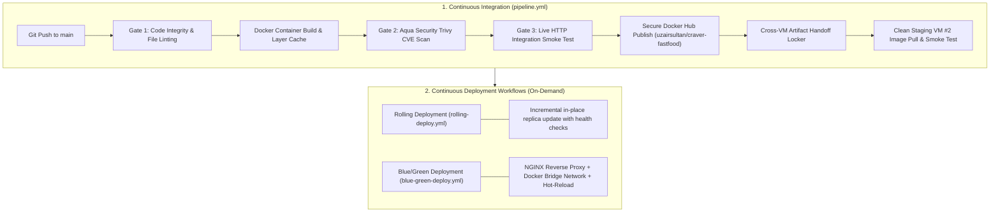

<div align="center">

# 🍔 Craver Fast Food Co.
### *Commercial-Grade Fast-Food Web Platform & Enterprise CI/CD Engine*

[](https://github.com/Uzair0123/craver-fast-food/actions/workflows/pipeline.yml)
[](https://github.com/Uzair0123/craver-fast-food/actions/workflows/blue-green-deploy.yml)
[](https://hub.docker.com/r/uzairsultan/craver-fastfood)
[](https://github.com/aquasecurity/trivy)

<br/>

[](https://developer.mozilla.org/en-US/docs/Web/HTML)
[](https://developer.mozilla.org/en-US/docs/Web/CSS)
[](https://developer.mozilla.org/en-US/docs/Web/JavaScript)
[](LICENSE)

<br/>

**[🌐 View Live Website](https://uzair0123.github.io/craver-fast-food/)** • **[🐳 Docker Hub Image](https://hub.docker.com/r/uzairsultan/craver-fastfood)** • **[⚙️ View CI/CD Pipelines](https://github.com/Uzair0123/craver-fast-food/actions)**

</div>

---

## 📌 Executive Summary

**Craver Fast Food Co.** is a commercial-grade, multi-page web application engineered with an enterprise-grade automated delivery pipeline. Built with a focus on **modular architecture**, **zero framework bloat**, and **automated continuous delivery**, it showcases full-stack web engineering backed by modern Cloud & DevOps best practices (Docker containerization, automated security scanning, multi-job artifact management, and zero-downtime deployment strategies).

---

## 🚀 Enterprise CI/CD & Delivery Architecture

The application is deployed and governed by an automated, multi-pipeline GitHub Actions architecture running across ephemeral cloud runners:



### 🛡️ The 3 Automated Quality Gates
1. **Gate 1 (File & Code Integrity):** Automatically verifies core website assets and Docker configurations before any compute resources are allocated.
2. **Gate 2 (DevSecOps Container Audit):** Integrates **Aqua Security Trivy (`@v0.36.0`)** to scan the built Docker image for known OS-level CVEs and vulnerabilities, automatically failing the build on `CRITICAL` or `HIGH` findings.
3. **Gate 3 (Integration HTTP Smoke Test):** Spins up a live background container on the cloud runner, waits for port availability with race-condition mitigations, and validates `HTTP/1.1 200 OK` header responses before passing.

### 🔄 Production Deployment Strategies
* **Docker Registry Delivery:** Automatically authenticates with Docker Hub using scoped Personal Access Tokens (PAT) and GitHub Secrets, pushing immutable container images with zero plaintext credential exposure.
* **Zero-Downtime Blue/Green Cutover:** Provisions an isolated NGINX reverse proxy on a custom Docker bridge network (`app-network`). Manages live traffic shifts from Blue (Port 8081) to Green (Port 8082) in < 1 second using Unix process signals (`nginx -s reload`) without dropping active connections.
* **Rolling Update Rollout:** Progressively terminates old container replicas, launches new versions on matching ports, verifies HTTP endpoints with `curl`, and guarantees continuous service availability.

---

## 🌟 Key Application Features

### 1. 🍽️ Dynamic Food Catalog & Filtering Engine (`menu.html`)
* **Multi-Category Navigation:** Instant category pill switching across 7 culinary categories (*Smash Burgers, Artisan Pizza, Crispy Chicken, Loaded Fries, Wraps, Shakes & Drinks, Desserts*).
* **Real-time Keyword Search:** Instant character-matching search filter across product names, descriptions, and categories with 0 delay.
* **Smart Sorting Engine:** Dynamic sorting by *Popularity*, *Top Rated (★)*, *Price: Low to High*, and *Price: High to Low*.
* **Dietary Tag Filtering:** Instant toggles for **🌿 100% Vegetarian**, **🌶️ Fiery Spicy**, and **🔥 Best Sellers**.
* **Zero-Friction Empty State:** Illustrated empty-result feedback with a 1-click **"Reset All Filters"** action.

### 2. 🔍 Interactive Quick-View Customization Modal (`js/modal.js`)
* **High-Resolution Inspection:** Detailed view displaying calories, ingredients, dietary badges, reviews count, and current vs. discounted price.
* **Live Price Stepper:** Interactive quantity increment/decrement `[-] [qty] [+]` that calculates and updates the CTA price in real time (*e.g. "Add 2 to Bag • $17.98"*).
* **Accessible Dismissal:** Supports outside backdrop taps, close button clicks, and keyboard `Escape` dismissal with body scroll-locking.

### 3. 🛒 Persistent Shopping Bag & Promo Engine (`cart.html`)
* **Itemized Cart Breakdown:** Real-time unit price, quantity steppers, item subtotals, and single-click removal.
* **Dynamic Promo Code Engine:**
  * `CRAVE40` ➔ 40% discount off meal subtotal.
  * `CRAVEFREE` ➔ $0.00 Free fast thermal delivery.
  * `WELCOME10` ➔ 10% welcome discount for new customers.
* **Automated Delivery Threshold:** Automatically grants **FREE Thermal Delivery** on orders over $25.00.
* **Cross-Page & Cross-Tab Persistence:** Centralized `storage.js` with `window.localStorage` sync ensures the header cart badge updates everywhere simultaneously.

### 4. 🚀 Express Multi-Step Checkout & Live Receipt (`checkout.html`)
* **Delivery Destination Form:** Captures Customer Name, Phone, Street Address, City, and Delivery Instructions with validation.
* **Interactive Payment Demo:** Select between *Cash on Delivery (Default)*, *Credit/Debit Card (with demo card fields)*, and *UPI / Apple Pay*.
* **Live Order Receipt Modal:** Generates an animated order receipt featuring a unique Order ID (*e.g. #CRV-8942*), itemized recap, and estimated 25-minute arrival countdown.

### 5. 📱 Touch-Optimized Mobile Navigation Drawer
* **Tactile Hamburger Menu:** 3-bar animated hamburger morphs into an `×` close icon.
* **Glassmorphic Slide-Out Drawer:** Smooth backdrop blur overlay with full-width touch links and quick hotline callout.

---

## 🏛️ System Architecture & Separation of Concerns

The project adheres to strict **modular decoupling**. Business logic, data schemas, DOM rendering, and persistence layers are segregated into discrete modules so that any single component can be modified without breaking others:

```text
                     ┌────────────────────────┐
                     │    data/products.js    │ (Single Source of Truth)
                     └───────────┬────────────┘
                                 │
                 ┌───────────────┴───────────────┐
                 ▼                               ▼
       ┌───────────────────┐           ┌───────────────────┐
       │    js/menu.js     │           │    js/modal.js    │
       │ (Catalog Render)  │           │ (Food Quick-View) │
       └─────────┬─────────┘           └─────────┬─────────┘
                 │                               │
                 └───────────────┬───────────────┘
                                 ▼
                     ┌────────────────────────┐
                     │     js/storage.js      │ <──> [ Browser LocalStorage ]
                     │  (State & Cart Badge)  │
                     └───────────┬────────────┘
                                 │
                 ┌───────────────┴───────────────┐
                 ▼                               ▼
       ┌───────────────────┐           ┌───────────────────┐
       │    js/cart.js     │           │  js/checkout.js   │
       │ (Bag Calculation) │           │ (Order Receipt)   │
       └───────────────────┘           └───────────────────┘
```

---

## 📂 Project Structure

```
fastfood-restaurant/
├── index.html              # Flagship Home & Showcase
├── menu.html               # Interactive Menu Catalog
├── about.html              # Brand Story, Standards & Chefs
├── contact.html            # 4-Way Store Hub, Form & FAQ
├── cart.html               # Shopping Bag & Cost Breakdown
├── checkout.html           # Express Checkout & Live Receipt
│
├── data/
│   └── products.js         # Structured JSON-like Products Database
│
├── css/
│   ├── variables.css       # Design Tokens (Palette, Typography, Spacing, Radii)
│   ├── reset.css           # Modern Box-Sizing & Normalization
│   ├── global.css          # Buttons, Badges, Toasts & Containers
│   ├── header.css          # Sticky Header, Top-Bar & Mobile Drawer
│   ├── home.css            # Hero, Categories, Best-Sellers & Deals
│   ├── menu.css            # Search, Filter Pills & Product Cards
│   ├── modal.css           # Quick-View Modal Dialog & Stepper
│   ├── cart.css            # Cart Table, Summary Card & Empty State
│   ├── checkout.css        # Multi-Step Forms & Order Receipt
│   ├── about-contact.css   # Story Pillars, Team & FAQ Accordion
│   ├── footer.css          # Operating Hours, Newsletter & Links
│   └── responsive.css      # Fluid Media Queries (320px to 1440px+)
│
├── js/
│   ├── app.js              # Application Coordinator & Dynamic Year
│   ├── navigation.js       # Header Elevation, Active Link & Drawer
│   ├── storage.js          # Centralized LocalStorage CRUD Manager
│   ├── toast.js            # Toast Notification Pill System
│   ├── menu.js             # Real-time Filter, Search & Sort Logic
│   ├── modal.js            # Food Customization Modal Controller
│   ├── cart.js             # Cart Engine & Promo Code Calculator
│   ├── checkout.js         # Checkout Validation & Order Processor
│   └── contact.js          # Contact Form & FAQ Accordion Controller
│
└── README.md
```

---

## 🎨 Design System Tokens

| Token | Hex / Value | Purpose |
| :--- | :--- | :--- |
| **`--color-primary`** | `#FF3838` | Craver Flame Red (Primary CTAs, active highlights) |
| **`--color-secondary`** | `#FFB800` | Cheddar Gold (Special deals, star ratings) |
| **`--color-dark`** | `#0F172A` | Obsidian Slate (Top announcement bar, footers) |
| **`--color-accent-green`**| `#10B981` | Fresh Mint (100% Vegetarian tags, success confirmations) |
| **`--color-bg`** | `#FAFAF9` | Warm Eggshell Neutral Background |
| **`--font-heading`** | `Plus Jakarta Sans`, `Outfit` | High-impact modern food brand typography |

---

## ⚡ Performance & Quality Highlights

* **Zero Dependencies:** Pure semantic HTML5, modern CSS3, and vanilla ES6+ JavaScript.
* **100% Mobile & Touch Friendly:** Meets WCAG accessibility minimums with $\ge 44\text{px}$ touch targets and zero horizontal viewport overflow.
* **Instant Load Times:** Lightweight assets with hardware-accelerated CSS Grid transitions and lazy-loaded image optimization.

---

## 🛠️ Local Development & Deployment Setup

### Option A: Launch with Docker (Recommended)
Pull and run the official production container image directly from Docker Hub:
```bash
# Pull and run on port 8080
docker run -d -p 8080:80 --name craver-app uzairsultan/craver-fastfood:latest

# Open in browser: http://localhost:8080
```

### Option B: Local Static Server (Python 3)
```bash
# 1. Clone the repository
git clone https://github.com/Uzair0123/craver-fast-food.git

# 2. Navigate to the project directory
cd craver-fast-food

# 3. Launch local server
python3 -m http.server 8080
```
Open **`http://localhost:8080`** in your browser.

---

## 👨‍💻 Author & Engineering Credits

**Uzair Sultan**  
*Systems Administrator • DevOps Engineer • Modern Web Architect*  
* **GitHub:** [@Uzair0123](https://github.com/Uzair0123)  
* **Portfolio:** [uzair0123.github.io/portfolio](https://uzair0123.github.io/portfolio/)  
* **Email:** [uzairteeli123456789@gmail.com](mailto:uzairteeli123456789@gmail.com)

---

<div align="center">
  <sub>Built with precision and passion by Uzair Sultan. Released under the MIT License.</sub>
</div>
